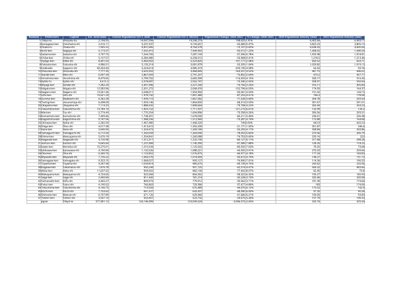

[](https://github.com/naosunnykonno/web-to-excel/actions/workflows/run-sample.yml)

[日本語](README.md) | [English](README.en.md)

# Web表データ → Excel 収集ツール

Webページ上の表（HTMLテーブル）を自動で取得し、整形済みの Excel ファイルに
落とすサンプルです。「ブラウザで表を見ながら Excel にコピペする」作業の自動化です。

## 入力 → 出力

- **入力**: 表のある公開WebページのURL
  （デフォルトは Wikipedia「都道府県人口一覧（英語版）」の表）
- **出力**: `output/prefectures_population.xlsx`
  - シート「Data」— 表そのもの。カンマ区切りの数値は Excel の数値型に変換済み
  - シート「取得情報」— 取得元URL・ページタイトル・**取得日時（JST）**・行数/列数。
    「いつの・どこのデータか」がファイル内に残るので、後から検証できます



実行結果（サンプル）：47都道府県＋全国計の48行×10列を取得。

## 使い方

```bash
pip install -r requirements.txt
python3 web_to_excel.py
# 別のページ・表を指定する場合
python3 web_to_excel.py "https://example.com/page" output/result.xlsx --table-index 0
```

## 対応できる実務の例

- 競合・市場調査のための公開データ（価格表・一覧表）の定期収集
- 公的統計やオープンデータの表を Excel 化してレポートに使う下準備
- 在庫・価格などの定期モニタリング（取得日時シートで履歴管理が可能）
- 収集 → 整形 → 月次レポートまでの一連の自動化

対象は公開ページの表データです。ログインが必要なサイトや、
利用規約で収集が禁じられているサイトは対象外です（実案件では事前に確認します）。

## 技術メモ

- Python / requests + BeautifulSoup + openpyxl
- `class="wikitable"` の表を優先抽出（Wikipedia形式）。無い場合はページ内の表を順に使用
- colspan のあるセルは値を横に展開して表の形を維持
- 数値らしいセルは自動で数値化（`1,234` → `1234`）。パーセント表記は文字列のまま保持
- Excelはヘッダー装飾・罫線・列幅自動調整・横向き印刷フィットまで設定済み

## サンプルデータについて

取得対象は Wikipedia の公開データ（CC BY-SA）です。
出力ファイルは本ツールの実行結果サンプルです。
